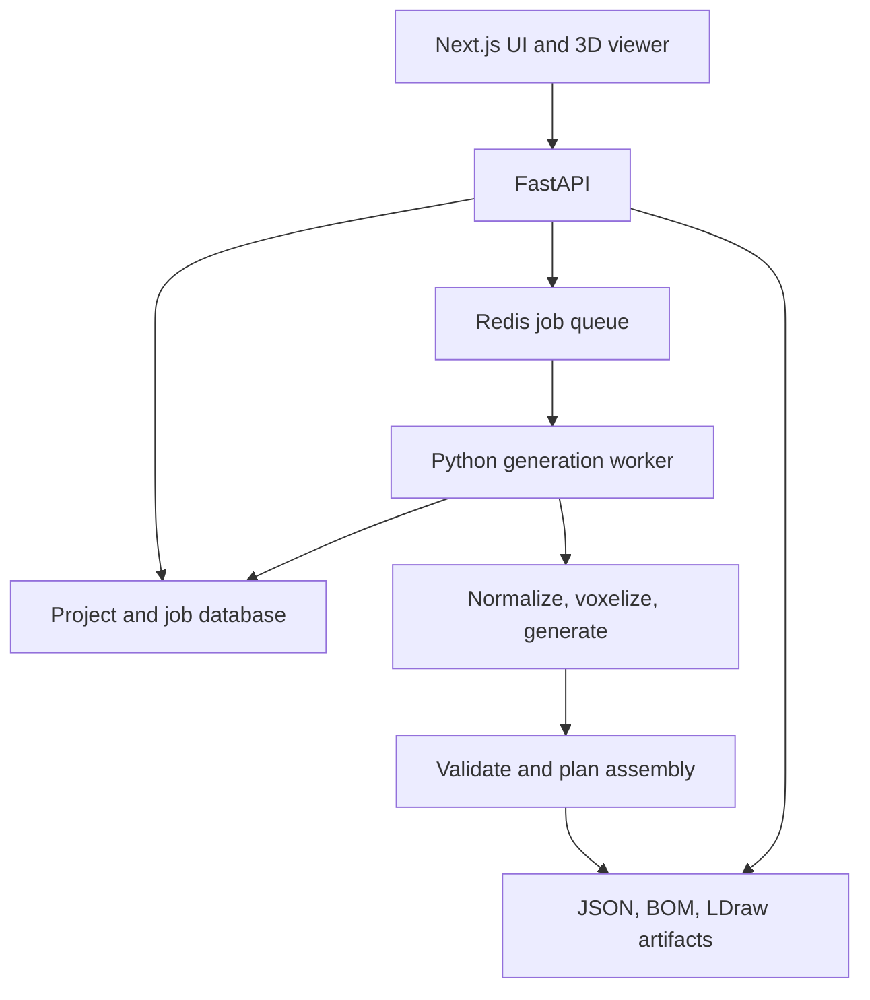

# BrickForge: PRD and Technical Design

Version 1.0 · October 27, 2026 · Owner: Yogya Mehrotra

Status: implementation proposal. BrickForge is a working name. Numeric limits and performance targets below are initial engineering defaults, not measured results. This document is intended to be handed directly to a coding agent.

## 1. Product definition

BrickForge converts a reference object into a LEGO-compatible brick design, an exact parts list, and visual assembly instructions. The long-term experience is: upload an image, choose a piece budget or available inventory, preview alternative designs, and build the result.

The first release accepts a 3D mesh and uses a deterministic geometry baseline. This establishes the representation, validators, viewer, and evaluation harness needed to train a model responsibly. The research release adds learned generation and RL refinement. Image input follows through an interchangeable image-to-3D adapter; it must not block the mesh workflow.

Example: upload a spaceship mesh, request at most 100 bricks, generate a connected approximation, rotate it in the browser, scrub through assembly steps, and download its parts list and LDraw file.

### What makes this project valuable

- Product: a complete path from a reference shape to a design someone can attempt to build.
- ML: compare deterministic generation, supervised learning, and RL under identical constraints.
- Research direction: shape fidelity versus limited inventory, piece count, and assembly feasibility.
- Portfolio evidence: reproducible benchmarks, visible failure cases, and several physical builds.

Do not claim novelty for generic AI brick generation. Existing projects include BrickGPT and BrickNet. The intended contribution must be supported by experimental results, especially inventory-constrained generation or instruction feasibility.

## 2. Users and jobs

Primary user: a hobbyist who wants a custom model from an object they like. Secondary user: an ML researcher comparing policies for constrained spatial generation.

| User story | Acceptance behavior |
|---|---|
| I want to upload an object | Supported mesh loads with a normalized preview and clear orientation controls |
| I want a small build | The candidate never exceeds the requested piece limit |
| I want to understand the result | I can rotate it, inspect the parts list, and view validation limitations |
| I want to assemble it | Instructions add actual stored pieces in a checked sequence |
| I want to use my own pieces | Later inventory mode never silently uses unavailable parts |
| I want to compare algorithms | The same inputs, seeds, limits, and evaluator work across generators |

## 3. Scope and release gates

### R0: engineering spike

CLI only: one synthetic target, one catalog, placement validation, JSON serialization, LDraw export, and browser rendering of the same build. Confirm axis transforms and part origins before building the full UI.

### R1: working MVP

- Input: single binary STL or single-file GLB containing static triangle geometry. Reject GLB external references, animation, and unsupported extensions. Flatten permitted node transforms; ignore materials and textures in R1.
- Single object, upright orientation selected by user; configurable scale on a fixed integer grid.
- Six regular brick types: 1×1, 1×2, 1×3, 1×4, 2×2, 2×4. Upright placement only; rotations 0 or 90 degrees. No hinges, slopes, plates, Technic, or sideways connections.
- One user-selected supported color. Every catalog part must exist in the selected color in the bundled manifest. Appearance matching is later work.
- Default cap 100 pieces; allowed 10–100. Default target box 16×16 studs and 8 brick layers; server caps at 24×24 studs and 12 layers.
- Deterministic baseline, validation report, interactive viewer, one-piece assembly steps, BOM CSV, build JSON, and LDraw export with step markers.
- Local project history. No accounts, public sharing, billing, shopping links, or arbitrary brick editing.
- A failed or partial reconstruction is a legitimate result; show diagnostics instead of inventing a complete build.

### R2: supervised generation

Train a compact shape-conditioned model on validated structures; evaluate against R1. This is the default ML path. Adapting an existing brick language model is an alternative experiment, not a dependency of R1.

### R3: inventory and RL

Add explicit per-part inventory counts, then fine-tune a sequential placement policy with geometric rewards. Compare inventory-aware heuristic, SFT, and SFT+RL. Maintain unrestricted catalog mode as a separate setting.

### R4: image input and richer outputs

Integrate an existing image-to-3D model, preview inferred hidden geometry, and reuse the mesh pipeline. Later additions: multiple colors, richer part types, alternative designs, grouped steps, printable PDF instructions, and physical-stability modeling. Each expanded part type needs new connection and collision rules.

## 4. User flow and interface

1. Create a project and upload a mesh, or choose a bundled demo.
2. Preview the target; select up direction and rotate in 90-degree increments. Choose target size, piece limit, and color.
3. Generate. Show queued/running stages and elapsed time; allow cancellation.
4. Inspect a side-by-side target and brick viewer, plus coverage, piece count, connectedness, and instruction status.
5. Enter build mode. Previous/next buttons and a slider show step k of N; new piece is highlighted, prior pieces remain visible, future pieces are hidden. Step zero shows only the ground plane.
6. Download the BOM, exact build JSON, and LDraw file. A structurally invalid candidate is available only as a diagnostic JSON, not as a validated build export.

Desktop-first design: settings column, central viewer, results/instructions panel. Use keyboard-accessible buttons and textual status labels. Save camera presets. The viewer must derive from stored placements, never a separately generated image.

UI language: distinguish “checks passed for the supported brick model” from “physically tested.” Do not label connectivity or a support heuristic as proof of physical stability. An unplanned result can still be inspected, but must not present invented instructions.

## 5. System architecture and stack



| Area | Decision | Reason |
|---|---|---|
| UI | Next.js, TypeScript, Tailwind | Familiar app stack with typed interfaces |
| Viewer | React Three Fiber, Three.js | Interactive placements and assembly playback |
| API | FastAPI, Pydantic | Python geometry integration and schema validation |
| Geometry | NumPy, trimesh | Mesh processing and baseline implementation |
| Persistence | SQLAlchemy + SQLite locally; PostgreSQL for hosted deployment | Local setup stays small; migrations through Alembic |
| Artifacts | Local filesystem adapter; S3 adapter later | Avoid cloud requirements for baseline development |
| Jobs | Celery + Redis | Durable background generation with bounded concurrency |
| ML | PyTorch; optional Transformers/PEFT for pretrained-model adaptation | Keep core generator independent of model family |
| RL | Gymnasium-style custom environment + PPO for structured actions | Fits direct brick-placement decisions |
| Alternate RL | TRL GRPO only for token-generating language-model policies | Different policy interface; do not mix training loops |
| Experiments | JSONL metrics locally; optional W&B | Every run is auditable without a hosted account |
| Verification | pytest, frontend typecheck, Playwright smoke flow | Geometry and UI consistency matter |

R1 runs without a GPU or model API key. Run training offline; the web worker loads versioned inference checkpoints only. Pin tested dependency versions in lockfiles during the implementation spike. Do not choose a specific GPU or spend cap until a measured training smoke run exists.

## 6. Canonical geometry and brick representation

### Coordinate convention

Internal axes: x and y are horizontal; z is up. x/y coordinates are integer stud locations at footprint corners. z is an integer plate-height unit. One regular brick occupies 3 z units. R1 z positions are multiples of 3. A stud pitch is 8 mm; plate height is 3.2 mm, so a brick body is 9.6 mm high. Stud protrusions are connector geometry, excluded from the simplified body collision boxes.

An upright placement occupies half-open body bounds [x,x+w) × [y,y+d) × [z,z+3). Rotation 90 swaps w and d; its anchor is still the minimum footprint corner after rotation. This avoids ambiguous rotations around a part center. Grid coordinates describe nominal geometry, not manufacturing tolerances.

The frontend uses an explicit conversion from canonical z-up to Three.js scene axes. LDraw export uses a separate tested transform, including each catalog part's native origin and LDraw's coordinate convention. Do not copy internal coordinates directly into either renderer.

### Catalog manifest

Each part entry stores: internal part key, footprint, height, stud locations, compatible underside connection locations, allowed rotations, supported color IDs, LDraw filename, native-origin transform, rendering asset path, and source/license metadata. Start with verified mappings for the six parts; do not infer marketplace IDs from LDraw filenames.

Use simplified procedural geometry for the initial viewer if needed. Actual LDraw part geometry is a later visual improvement; matching placement transforms is required either way. Restrict part paths to the bundled manifest.

### Build contract

```json
{
  "schema_version": "1.0",
  "build_id": "build_demo_001",
  "catalog_version": "basic-bricks-v1",
  "coordinate_system": "stud_xy_plate_z_v1",
  "generator": {"name": "greedy_v1", "version": "0.1.0", "seed": 42},
  "constraints": {
    "max_pieces": 100,
    "bounds": {"x_studs": 16, "y_studs": 16, "z_plates": 24},
    "color_id": "4",
    "inventory_mode": "unrestricted",
    "inventory": null
  },
  "placements": [
    {"id": "b0001", "part_key": "brick_2x4", "x": 0, "y": 0, "z": 0, "rotation_deg": 0, "color_id": "4"},
    {"id": "b0002", "part_key": "brick_2x2", "x": 0, "y": 0, "z": 3, "rotation_deg": 0, "color_id": "4"}
  ],
  "steps": [
    {"index": 1, "added_placement_ids": ["b0001"]},
    {"index": 2, "added_placement_ids": ["b0002"]}
  ]
}
```

A build is an immutable artifact. Validation reports, mesh normalization metadata, metric results, and planning diagnostics are separate artifacts keyed by build hash. IDs must be unique; steps must partition placements exactly once. BOM is derived from placements by (part_key, color_id); never ask a model to invent counts.

Future inventory mode uses counts keyed by (part_key, color_id); unspecified entries mean zero. Null inventory means unrestricted within the catalog, never zero stock. Temporary construction fixtures and ground are not available inventory.

## 7. Mesh-to-bricks baseline

### Input processing

Enforce 20 MiB upload and 200,000-triangle decoded limits. Limit scene nodes and decoded buffers, run parsing with a timeout, and disable external resource resolution. Validate finite coordinates and nonzero bounds. Persist original bytes and SHA-256 hash.

Apply user orientation, center horizontally, place the lowest point at z=0, and scale uniformly to fit physical target dimensions. Respect the unequal horizontal and vertical unit lengths; avoid squashing meshes to a cubic index grid. Save the source-to-canonical transform. Require a watertight volume for R1; report a specific error for open meshes rather than silently filling unknown interiors. A future repair mode may explicitly alter the input.

Voxelize the solid into a grid of one stud × one stud × one brick height. Persist occupancy plus dimensions and scale. Display the voxel preview so fidelity losses are visible before generation. R1 targets solid approximations; hollow shells are a later optimization.

### Deterministic generator

1. Build a baseline 1×1 occupancy cover on the target grid for diagnostics; it may exceed the budget and is not automatically a valid output.
2. Construct a candidate bottom-up. Enumerate upright placements with substantial target overlap, within bounds, and no collisions.
3. Require each new non-ground piece to have a valid stud connection to the existing assembly. Ground seeds may initially be separate, but the final build must be one connected component. Do not treat side-by-side contact as a connection.
4. Rank candidates by newly covered target cells, extra occupied cells outside target, number of distinct lower bricks connected, and piece cost. Use deterministic tie-breaking and a recorded seed for any optional variation.
5. Try offset patterns across layers and a bounded set of candidate orderings. Allow penalized non-target filler when it enables bridges. Keep a small beam only if the greedy baseline demonstrably fails important fixtures.
6. Stop at the piece cap or when no useful valid placement remains. Never relax the cap, collision rules, or inventory silently.
7. Validate final candidates and attempt instruction planning. Select the best valid candidate using a documented fidelity score; retain failed candidates for diagnostics.

This algorithm is an initial heuristic, not a guarantee of reconstruction. Disconnected targets, thin structures, and unsupported overhangs may need approximation. Return the best valid partial candidate with low-coverage warnings, or fail when no connected candidate can be produced.

## 8. Validation and assembly planning

### Structural validator

- Schema, known catalog entries, finite integer coordinates, legal colors and rotations.
- All body bounds within the build region; no positive-volume body overlap.
- Piece count and optional inventory limits.
- Stud-to-underside compatibility for bricks touching vertically. Side contact does not create an edge.
- Connection graph with one component for a finished build.
- Ground contact and per-piece support diagnostics.

The validator is authoritative and model-independent. Add a clearly labeled support heuristic, such as projected center of mass against support regions, only as a diagnostic until its assumptions are validated. A rigid-body engine alone does not model stud clutch strength; future physical simulation needs calibrated connectors.

### Assembly planner

R1 uses one piece per step, upright insertion from above, and a horizontal work surface. Begin with a ground piece. Search over remaining placements that (a) do not collide with placed bodies, (b) attach to the assembled component, and (c) have a clear downward insertion path under the simplified body/connector model. Check the swept footprint from above the assembly to its destination. Deterministic tie-break: low z, stronger lower connectivity, then ID. Backtrack with fixed node/time budgets when greedy ordering fails.

Reject an order that leaves a required lower piece inaccessible. A final connection graph can be valid while the build sequence fails. Planner timeout means `planning_unknown`, not `proven_unbuildable`. `planning_failed` means no order was found within the supported rules; describe the search limit. Save the exact checked order.

Planning validation covers a restricted geometry model. Hand clearance, required insertion force, and actual robustness remain unverified until tested. Unsupported assemblies should not get an optimistic “buildable” label.

## 9. API, jobs, persistence, and errors

### Endpoints

| Endpoint | Purpose |
|---|---|
| POST /v1/projects | Create project |
| POST /v1/projects/{id}/assets | Multipart mesh upload; return asset metadata |
| POST /v1/projects/{id}/jobs | Generate using asset_id, generator, normalized options, seed |
| GET /v1/jobs/{id} | State, stage, progress, diagnostics, artifact references |
| POST /v1/jobs/{id}/cancel | Cooperative cancellation |
| GET /v1/projects/{id} | Project with builds and jobs |
| GET /v1/builds/{id} | Canonical build and report references |
| GET /v1/builds/{id}/artifacts/{kind} | Authorized JSON, BOM, LDraw, report download |
| GET /v1/catalog | Versioned supported catalog |
| GET /health | API availability; separate worker/queue readiness details |

Do not accept local paths or arbitrary URLs in API requests. Generate storage keys server-side. Poll every 1–2 seconds in R1; websocket infrastructure is unnecessary.

### Job semantics

State machine: queued → running → succeeded | failed | cancelled. Running stages: normalize, voxelize, generate, validate, plan, export. `succeeded` means the pipeline produced a result; inspect result status `validated_candidate`, `partial_candidate`, or `no_valid_candidate`. Generation failure must not appear as success with a fabricated demo model.

Create an idempotency key from source hash, orientation/size options, catalog, generator/checkpoint version, and seed. A client retry with the same key returns the existing job. Do not include project-private identifiers in cross-user caches. Worker retries must not duplicate builds. Record cancellation in the database; workers check between stages and within bounded search loops. Write artifacts to a temporary directory and atomically publish only once; database reconciliation handles interrupted publication.

Tables: Project, Asset, GenerationJob, Build, Artifact. Store immutable config snapshots, timestamps, stage timings, source hashes, generator/checkpoint hashes, and structured error codes. Suggested codes: invalid_mesh, non_watertight_mesh, input_limit_exceeded, unsupported_input, no_valid_candidate, planner_budget_exceeded, worker_timeout, artifact_write_failed.

R1 binds to localhost and assumes one trusted local user. Before network exposure, add authentication, per-project authorization on every route/artifact, request throttles, isolated parsing, upload cleanup, and resource quotas. Keep uploaded content and model data out of logs.

## 10. ML design and dataset

### Default learned generator

Use a compact shape encoder and an autoregressive decoder that predicts a brick action: part type, x, y, z, rotation, then STOP. R1 color is supplied as a constraint. Encode target occupancy with a small 3D CNN; encode current occupied cells or a placement history. Start with a size that can overfit a tiny dataset on one available GPU; architecture size is an experiment, not a product constraint.

Implement the canonical generator interface:

`generate(target, catalog, constraints, seed, cancellation) -> CandidateResult`

The baseline, learned policy, and optional pretrained-model adapter must implement the same interface. Validators and exports never change with the generator.

### Training examples

Source structures must be permitted by their licenses, use the supported catalog, and pass the structural validator. Save source URL/license, original structure ID, conversion version, and validation report. Render multiple views for future image conditioning; for mesh conditioning, derive occupancy from the structure union and optionally use separately paired target shapes.

Construct legal action sequences through the planner; consider alternative valid orders as augmentation. Training a model on self-generated structures teaches legal structure reconstruction, but does not automatically teach arbitrary organic shapes or artistic creativity. Keep this domain gap explicit.

Split by original structure family before producing renders or order variations. All rotations, near-duplicates, views, and derived sequences remain in one split. Suggested split 80/10/10. Keep synthetic training structures separate from a held-out suite of externally sourced target meshes.

First gate: overfit 32 examples and reconstruct them through the production decoder/validator. Then grow data; do not launch a large training run before end-to-end inference works.

SFT objective: cross-entropy over action fields with teacher forcing and legal-action masks. Include STOP. Watch for exposure bias; log free-running validation metrics, not only teacher-forced loss. Constrained decoding is applied consistently at training where relevant and at inference; report both raw proposal validity and post-mask output validity.

## 11. RL experiment

Implement after baseline, SFT, and evaluator pass their gates. Default: PPO over the structured policy; warm-start from SFT. If choosing an existing language-model policy instead, evaluate TRL GRPO as a separate implementation branch with a token grammar and parser. Do not bolt GRPO onto an arbitrary categorical-action network.

Environment observation: target occupancy/features, current assembly, remaining inventory, remaining piece budget. Action: legal brick placement or STOP. Transitions place a brick. Episode ends on STOP, cap, no legal placement, or failure. The mask enforces collisions, bounds, catalog, and stock constraints. Prefer a bounded candidate generator to an enormous dense Cartesian action tensor; use the same candidate/mask conventions in training and deployment. Measure achievable target coverage under these rules before training.

Initial reward proposal:

`r_t = fidelity(s_next) - fidelity(s_current) - lambda_piece`

Terminal bonuses/penalties cover final connectedness, checked planning outcome, and premature STOP. Fidelity can be target occupancy IoU. Empty output receives zero fidelity and cannot gain positive reward just for stopping. No learned reward model is required initially. Keep hard constraints out of a reward-only tradeoff. Record individual reward components and tune weights only on validation data.

Stress tests: tiny connected towers, a wide bridge, empty output, dense cube, early STOP, excessive filler, and shape-mismatched but connected designs. These expose reward hacking. Report if the policy sacrifices resemblance to satisfy easy physical proxies.

Run ablations: baseline; SFT; SFT+RL; SFT with matched best-of-N inference; RL without fidelity reward; inventory-aware baseline versus learned methods. Match evaluation budgets and sample counts. Separate policy improvement from gains caused by extra search or rejection filtering.

## 12. Evaluation and acceptance criteria

### Metrics

| Metric | Definition |
|---|---|
| Target IoU | Intersection/union of occupied cells in the canonical grid |
| Coverage | Target cells occupied by generated bricks / target occupied cells |
| Extraneous occupancy | Generated cells outside target / generated occupied cells |
| Structural validity | Fraction passing all declared structural hard constraints |
| Planning success | Fraction with a complete checked insertion sequence |
| Inventory violations | Excess pieces by part/color; zero for accepted inventory results |
| Piece count | Exact placements; report with fidelity, not as a standalone quality score |
| Latency | Per-stage and end-to-end wall time, hardware, concurrency, and search budget |
| Physical build outcome | Human assembly completion, instruction corrections, and observed failures |

Evaluate at least 30 held-out meshes across simple objects, vehicles, furniture, and difficult thin/overhang cases. Include procedural fixtures with known expected behavior. Publish per-object results, failures, and aggregate distributions; avoid evaluating only curated successes. For stochastic models use fixed test seeds and report mean/variation. Run a 100-target expansion before strong comparative claims.

### R1 release gates

- Fresh checkout starts API, worker, and UI using documented commands and bundled demos, without GPU or external secrets.
- Same source/options/version/seed yield identical ordered placements and metrics.
- Every accepted candidate has zero collision, bounds, catalog, and budget violations and exactly one connection component.
- BOM counts and viewer pieces exactly equal stored placements.
- Every exported step sequence includes every brick once and passes replay validation.
- A canonical two-brick fixture agrees across JSON, viewer, and LDraw with tested axis/origin transforms.
- At least 8 of 10 predetermined simple supported fixtures produce valid candidates with coverage ≥0.80 at the allowed budget. Freeze fixtures before tuning.
- Difficult or impossible fixtures return explicit partial/failure states.
- Initial performance target: ≤30 seconds baseline generation on the default 16×16×8 grid and 100-piece cap on the documented developer CPU; parsing and search have independent timeouts. Measure before promising a hosted SLA.
- Instruction playback remains responsive for 100 pieces on the documented test browser/device.
- Three small outputs physically assembled, with photos and corrections recorded, before describing the product as physically validated. This is a product/research gate, not a coding-agent task to fake.

ML success is not a predeclared percentage improvement. Report actual held-out quality versus baseline, validity, compute, and limitations. A negative result is acceptable if reproducible.

## 13. Repository and implementation sequence

```text
apps/web/                 Next.js UI and viewer
services/api/             FastAPI routes, persistence, migrations
services/worker/          Job orchestration
packages/brickcore/       Catalog, schemas, geometry, validators, planner, exporters
ml/                      Dataset tools, policies, SFT, RL, evaluation
catalog/                 Versioned part manifest and licensed assets
fixtures/                Synthetic meshes and expected builds
configs/                 Generation and experiment configurations
docs/                    Setup, geometry decisions, benchmark results
```

Python schemas are authoritative. Generate TypeScript types from OpenAPI or JSON Schema; do not maintain divergent placement contracts manually.

| Milestone | Deliverable | Dependency / gate |
|---|---|---|
| M0: representation | Catalog, build schema, two-brick fixture, transforms | Verify rendering/export agreement |
| M1: geometry core | Mesh normalization, voxelizer, validator, CLI baseline | Deterministic fixtures; meaningful failure states |
| M2: instructions | Planner, replay validator, BOM and LDraw | Complete steps and export consistency |
| M3: application | Upload, jobs, viewer, instructions, downloads | End-to-end browser smoke test |
| M4: evaluation | Held-out manifest, runner, per-case metrics | Freeze baseline and benchmark |
| M5: SFT | Data pipeline, tiny overfit, checkpoint inference | Compare free-running outputs to baseline |
| M6: inventory/RL | Stock constraints, environment, PPO, ablations | No silent violations; measured comparison |
| M7: image adapter | Image-to-3D integration and shape preview | Mesh path remains available; no hidden preprocessing changes |

### First coding-agent task

Read this document and inspect the repository's existing instructions. Implement M0, then M1; do not start model training or cloud deployment. Add a CPU-only CLI command that converts a bundled mesh to build JSON and validation JSON. Include a README, pinned environment, and meaningful tests for collision, true stud connections, transforms, serialization, budgets, and deterministic output. Demonstrate one supported success and one intentional failure. Report actual commands/results, decisions, and known limits. Stop at this concrete milestone for review before expanding architecture.

### Working rules for subsequent agent tasks

- Keep geometry/business logic in brickcore, separate from API and UI.
- Never substitute mocked placements for failed real generation. Label demo assets clearly.
- Never bypass validation to improve benchmark scores or satisfy the UI.
- Implement one milestone at a time; update setup and architecture decisions as they become concrete.
- Mock external services in tests, but exercise real geometry on small fixtures.
- Use bounded jobs, cancellation checks, deterministic configs, and versioned artifacts.
- No paid compute, model downloads requiring acceptance, dataset redistribution, or public deployment as an implicit side effect of coding.

## 14. Risks and decisions still to validate

| Risk / question | Current decision and next check |
|---|---|
| Basic bricks produce blocky designs | Establish shape baseline first; measure user preference before adding parts |
| Is the simplified assembly model useful? | Restrict insertion rules; physically test examples and document missing forces |
| Can greedy search bridge layer components? | Test bridge fixtures early; bounded search/filler before learned generation |
| Data licensing and diversity | Record provenance; choose an actually usable dataset before SFT |
| Which pretrained model, if any? | Optional adapter spike after baseline; do not select by parameter count alone |
| GPU cost and training time | Run tiny overfit/profile first, then set explicit run budgets |
| Photo reconstruction is ambiguous | Show inferred mesh and allow orientation/scale corrections |
| Creativity is subjective | Later human preference study of multiple valid candidates; do not equate IoU with creativity |
| Part asset integration | Verify origins, color availability, and license notices during M0 |
| Inventory narrows feasible designs | Offer approximate results with explicit fidelity metrics; never invent stock |

## 15. References and source boundaries

These references support format/integration choices and prior art, not the performance targets or proposed algorithms above. Recheck upstream licenses, APIs, and checkpoint compatibility during implementation.

- LDraw file format specification: https://www.ldraw.org/article/218.html — part references, transforms, and step metadata.
- Three.js LDrawLoader documentation: https://threejs.org/docs/pages/LDrawLoader.html — loading models and resolving/packing part dependencies.
- BrickGPT official repository: https://github.com/SpyrosKou/brickgpt — prior work and an optional pretrained-model/data investigation. Do not assume its catalog or constraints match this project.
- BrickNet project: https://kulits.github.io/BrickNet/ — prior work on graph-based brick assembly generation; review before making novelty claims.
- Hugging Face TRL GRPO documentation: https://huggingface.co/docs/trl/grpo_trainer — custom rewards for the optional language-model policy branch.

## 16. Definition of done

The first complete product milestone is a reproducible local application that takes a supported mesh, produces an honestly labeled candidate, shows the exact stored bricks and checked assembly steps, and exports matching parts and model files. The research milestone is a measured comparison showing what supervised learning and RL change under the same geometry, inventory, and evaluation rules.
