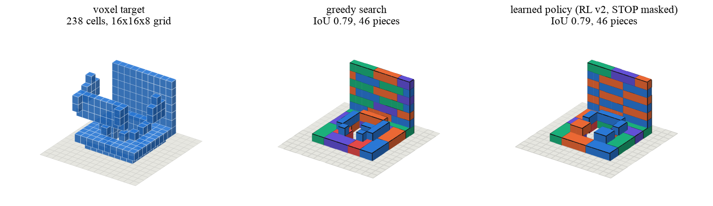

# BrickForge

**Turn any 3D model into a buildable LEGO-style brick model, with a parts list and step-by-step instructions.**

Give BrickForge a 3D mesh (an `.stl` or `.glb` file). It snaps the shape onto a grid of studs, picks bricks from a
small catalogue, checks that every brick sits on something, that nothing overlaps, that the whole thing is one
connected piece, and that it holds together under a simple physics model. Then it writes out the build, a bill of
materials, an LDraw file, and an assembly order you can scrub through in your browser.



*Left: a Thingi10K mesh voxelized onto a 16 x 16 x 8 grid. Middle: the build from the hand-written search.
Right: the build from the learned policy. Colours only separate neighbouring bricks.*

It is also a small research project. Three different "brains" can choose the next brick: a hand-written greedy
search, a tiny neural network (about 100k parameters) trained to imitate that search, and the same network
improved with reinforcement learning. All three are compared on the same frozen benchmark, under the same rules,
at piece budgets of 50, 100 and 200. The write-up lives in [`paper/`](paper/) and the short version is below.

Everything runs on a laptop. No cloud, no GPU required for using it (training used an Apple M5 Pro).

---

## Quick start

You need [`uv`](https://docs.astral.sh/uv/) and Python 3.12.

```sh
git clone https://github.com/yogyam/BrickForge.git
cd BrickForge
make setup      # creates the virtualenv and installs what the greedy pipeline and the viewer need
make setup-ml   # optional: adds PyTorch so the learned policies can run too
make demo       # builds a sphere, shows an intentional failure, then builds the sphere again with the learned policy
```

The full hands-on tour, with every output explained, is [`docs/demo.md`](docs/demo.md).

Then build something of your own:

```sh
./bf generate --mesh path/to/your_model.stl --out runs/my_model --max-pieces 100
```

Open [`viewer/index.html`](viewer/index.html) in any browser (no server needed), load
`runs/my_model/build.json`, and step through the assembly with the slider or the arrow keys. Load the matching
`voxels.json` to see the target shape, and `stability.json` to see how each step fares under the force model.

> **Working from an iCloud-synced folder?** (`~/Desktop` and `~/Documents` usually are.) The virtualenv has to live
> outside it, because iCloud hides dot-directories and Python then cannot find the project. `make setup` and
> `./bf` already handle this by using `~/.venvs/brickforge`. If you want plain `uv run` to work too, add
> `export UV_PROJECT_ENVIRONMENT=$HOME/.venvs/brickforge` to your shell profile.

---

## What you get

`./bf generate` writes a folder with:

| file | what it is |
|---|---|
| `build.json` | every brick: type, position, rotation, colour, plus the checked assembly steps |
| `bom.csv` | the parts list (how many of each brick) |
| `build.ldr` | an LDraw file you can open in LDView, Stud.io or similar |
| `voxels.json` | the target shape as grid cells, for the viewer |
| `validation.json`, `plan.json`, `stability.json` | the checker reports: legality, assembly order, force model |
| `normalization.json` | how the mesh was rotated, scaled and placed on the grid |
| `result.json` | the outcome in one place: status, fidelity, timings |

The status is one of four honest words. `validated_candidate` means everything passed. `partial_candidate` means
the build is legal but covers less than 80 % of the shape, or some pieces had to be dropped because they were not
connected. `no_valid_candidate` means no legal build was found. `failed` means the input itself was rejected (for
example a mesh with holes in it). BrickForge never invents a build to hide a failure.

**Useful options for `generate`:** `--max-pieces N` caps the build (1 to 200); `--size X Y Z` sets the grid in studs
and brick layers (default `16 16 8`, up to `24 24 12`); `--up +z` says which axis of your model points up;
`--color 4` picks the brick colour (LDraw colour codes); `--generator rl_v2_nostop` or `sft_v2` swaps the greedy
search for a learned policy (needs `make setup-ml` and `uv run --group ml brickforge ...`). The full list:
`./bf generate --help`.

**Other commands:** `./bf validate build.json`, `./bf plan build.json --write` (recompute the assembly order),
`./bf stability build.json` (force model, final build and every step), `./bf export build.json --out dir`,
`./bf fixtures` (write the 13 test shapes used below).

---

## How it works, in plain words

1. **Voxelize.** The mesh is rotated upright, scaled to fit the grid, and each grid cell is marked "inside" or
   "outside". The grid is 16 studs by 16 studs by 8 brick layers, so 2048 cells.
2. **Place bricks.** A generator picks bricks one at a time from six types (1x1, 1x2, 1x3, 1x4, 2x2, 2x4). It may
   only choose *legal* placements: inside the grid, not overlapping anything, resting on the ground or on a brick
   below, covering at least one target cell, and not mostly filler.
3. **Trim.** Bricks only connect through studs. Anything not connected to the ground through studs is removed, so
   the result is one object you could pick up.
4. **Plan.** An assembly order is computed, one brick per step, each dropped straight down onto what is already
   there, never sealing off a brick that still has to go in.
5. **Validate.** An independent checker replays the steps and confirms every rule.
6. **Stability check.** A simplified static force model (in the style of
   [StableLego](https://arxiv.org/abs/2402.10711)) asks whether the studs can hold the weight. The answer is always
   labelled *"stable under the simplified static force model; not physically tested"*, because that is exactly what
   it is.

Steps 3 to 6 are identical for every generator. Only step 2 differs, which is what makes the research comparison
fair.

---

## The research in one paragraph

Three generators were compared on a frozen benchmark of 53 held-out shapes (13 procedural fixtures and 40 Creative
Commons meshes from Thingi10K) at budgets of 50, 100 and 200 pieces, scored by how well the finished build overlaps
the target (intersection-over-union, failed builds counted as 0). At the 200-piece cap the hand-written search
scores 0.705. The learned policy after reinforcement learning scores 0.693, ties the search on procedural shapes,
matches its validity and stability counts, and takes under 0.2 s per shape; a second training seed lands on the
same number. Fidelity barely improves from 100 to 200 pieces for any generator, because builds stop when no legal
placement remains, long before the cap. Three things did not work and are reported as such: the policy's learned
"stop" action is unreliable on real meshes and is masked at decode time; a stability bonus in the reward turned out
to be redundant because the hard rules already enforce it; and the connectivity inputs only matter where the policy
judges on its own.

| generator | 50 pieces | 100 pieces | 200 pieces | valid | stable* |
|---|---|---|---|---|---|
| greedy search (baseline) | 0.621 | 0.696 | **0.705** | 51/53 | 49/53 |
| imitation (SFT) | 0.566 | 0.653 | 0.662 | 49/53 | 48/53 |
| imitation + RL, stop masked | 0.609 | 0.682 | **0.693** | 51/53 | 49/53 |

*Mean IoU over the 52 attemptable cases; SFT and RL rows are the mean of two training seeds. \*Stable under the
simplified static force model; not physically tested. The two invalid cases are deliberate (an open mesh and a
one-cell pole), so 51 is the ceiling.*

The two headline checkpoints (`checkpoints/sft_v2.pt`, `checkpoints/rl_v2.pt`, about 400 KB each) are committed, so
the three-way comparison can be run from a fresh clone with `--generator`; see [`docs/demo.md`](docs/demo.md).

Full details, figures and the failure analysis: the paper in [`paper/`](paper/) (`make paper` builds the PDF),
[`docs/rl.md`](docs/rl.md), [`docs/sft.md`](docs/sft.md) and the benchmark records in
[`docs/benchmarks/`](docs/benchmarks/).

---

## Reproducing the research

Everything is a `make` target. Times are for an Apple M5 Pro laptop.

```sh
make test                                          # the test suite without torch (RL tests skip); make test-ml runs everything
make bench                                         # frozen greedy baseline + audit (downloads ~100 MB of meshes once)
make sft-gate                                      # 2-minute sanity check that the policy can learn at all
make sft-train sft-bench                           # imitation, v1 data (~25 min) + benchmark
make rl-gate                                       # 5-minute sanity check for PPO
make rl-train rl-bench                             # RL from sft_v1 (~2.5 h) + benchmark
make data-v2 sft-train-v2 rl-train-v2 rl-bench-v2  # the rebalanced-data ladder (~1.5 GB of meshes, ~2.5 h)
make v2-seed1 rl-bench-v2-seeds                    # the same ladder with a second training seed (~3 h)
make rl-ablations rl-bench-v2-ablations            # the two ablations (~5 h)
make paper                                         # regenerate every figure and compile the PDF
```

Every benchmark file can be re-checked with `./bench audit docs/benchmarks/<name>.jsonl`, which regenerates each
record from scratch and compares it with what the file claims. Decoding runs on CPU and is bit-identical across
machines. Meshes, training logs and all other checkpoints are downloaded or produced locally and never committed.

---

## Known limits

- One grid size at a time, solid fill, six upright bricks, one colour. No plates, slopes or hollow shells yet.
- Thin or hollow objects can occupy only a few dozen cells at this resolution and may break into islands; the
  trim then keeps the largest one. A finer grid is the fix, and it is a documented limitation rather than a
  surprise.
- The greedy search builds bottom-up and cannot reach overhangs more than one brick wide; it reports them as
  uncovered rather than faking them.
- Stability is a model, not a test. No build in this project has been assembled physically.
- The viewer draws plain boxes, not real LDraw part geometry (LDraw part files are not bundled).

---

## Project layout

```
brickcore/   the core: catalogue, build schema, geometry, voxelizer, greedy search, validator, planner,
             stability model, LDraw/BOM export, CLI
ml/          data generation, the policy network, SFT and PPO trainers, learned generators, benchmark runner
catalog/     basic-bricks-v1.json, the six-brick catalogue
fixtures/    the 13 procedural test shapes and a two-brick reference build
viewer/      the static Three.js viewer (open index.html)
docs/        design notes (geometry, planner, stability, benchmark, SFT, RL, MCP) and docs/benchmarks/ results
paper/       the paper: LaTeX source, figure scripts, cached builds, number macros
tests/       pytest suite
```

`./bf` and `./bench` are small wrappers that run the two command-line tools inside the right virtualenv. There is
also an MCP server (`docs/mcp.md`) that lets an AI assistant generate, validate and inspect builds.

The original product and design document is [`BrickForge_PRD_Design_Doc.md`](BrickForge_PRD_Design_Doc.md).
